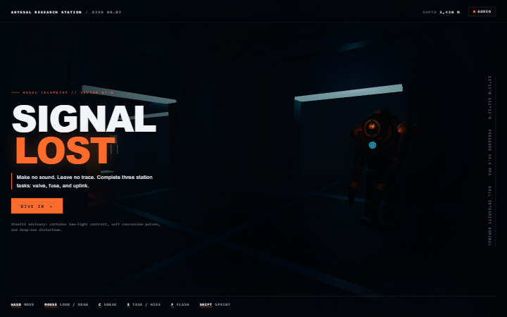
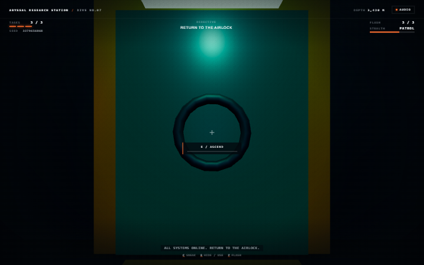

# SIGNAL LOST

A procedural full-3D deep-sea stealth horror game running entirely in the browser without build steps or external network assets.





## Features

- **Procedural Sub-Station Layouts**: Every run generates a deterministic 3x3 facility grid from a seed, complete with looping corridors, industrial obstacles, locker hiding spots, and closed patrol circuits.
- **Perception-Driven Predator AI**: The entity operates across five hunting stages (`patrol`, `notice`, `search`, `chase`, `blinded`), investigating acoustic disturbances and visual contact through line-of-sight pathfinding rather than omniscient wallhacks.
- **Three Distinct System Objectives**: Restore power by holding a high-pressure valve, inserting three fuses with separate presses, and triggering an autonomous transmission uplink.
- **Acoustic Stealth & Locker Hiding**: Monitor your sound profile via the HUD noise meter; crouch to quiet footsteps, or conceal yourself inside lockers when breaking line of sight to evade pursuit.
- **Tactical Flashbang Countermeasures**: Deploy up to three handheld flash canisters to stun the predator for 5 seconds when within unobstructed range and sightlines, providing an escape window rather than a lethal weapon (+1 resupply per completed objective).
- **Self-Contained Architecture**: No external network requests at runtime. Three.js is vendored locally; environments, models, and audio are procedural.

## Quickstart

Playing requires **Node.js 20+** (or any static HTTP server). No build step, package installation, account, or internet connection is required.

```sh
node server.mjs
```

Open **http://localhost:5173** in your browser.

> [!NOTE]
> Opening `index.html` directly via `file://` does not support standard ES module loading; serve the root via `server.mjs` or another static file server.

### Development & Automated Tests

Automated testing is optional and relies on dev dependencies:

```sh
npm install
npm test
npx playwright install chromium
npm run test:browser
```

*Browser automation was verified in Chromium. Firefox has not been verified: external browser launch was unavailable in the test environment.*

## Controls

| Input | Action |
| --- | --- |
| **W, A, S, D** | Move (forward, strafe left, backward, strafe right) |
| **Mouse / Drag** | Look around (pointer lock supported; drag-to-look fallback for touch/unlocked pointers) |
| **C** | Toggle crouch (quieter footsteps, reduced movement speed) |
| **Shift** | Sprint (consumes a 4-second stamina gauge) |
| **E** | Interact with objectives (hold valve, fit fuse, initiate uplink) / Enter & exit lockers / Ascend at airlock |
| **F** | Throw tactical flashbang canister (resupplies +1 per restored system, max 3) |
| **Esc / P** | Pause / resume game |
| **Restart** | Re-rolls layout with a fresh procedural seed |

## Survival & AI Mechanics

- **Hearing & Line of Sight**: The entity tracks acoustic signatures (footsteps, sprinting, valve turning, fuse clicks, and uplink transmissions). Upon hearing noise, it enters `notice` stage to inspect the disturbance's last known location. If it loses visual contact during a `chase`, it combs the surrounding area in `search` before resuming standard `patrol`.
- **Noise Gauge**: The HUD noise meter visualizes the amplitude of sounds emitted. Sneaking (`C`) lowers acoustic footprint significantly compared to normal walking or sprinting.
- **Lockers**: Entering a locker conceals you from visual detection. You cannot hide if the creature actively maintains direct line of sight within close range—break sight around corners first.
- **Tactical Flash**: The flashbang produces an intense optical blast. When detonated within line of sight and 9 units of the predator, it triggers a 5-second `blinded` stage, disabling vision and drastically slowing the creature so you can slip away.

## Architecture & Code Map

```
├── index.html            # Game viewport, tactile HUD elements, and audio initialization
├── server.mjs            # Zero-dependency Node.js static HTTP file server
├── src/
│   ├── main.js           # Engine loop, input dispatch, player physics, and state transitions
│   ├── layout.js         # Seeded layout generator (room graph, doors, obstacles, patrol loops)
│   ├── world.js          # Procedural station geometry, materials, lighting, and locker meshes
│   ├── creature.js       # Procedural deep-sea predator 3D model, animation, and rigs
│   ├── ai.js             # State-machine AI (patrol, notice, search, chase, blinded) & perception
│   ├── objectives.js     # State and logic for valve (hold), fuse (3 pulses), and uplink (autonomous)
│   ├── flashbang.js      # Physics simulation, bounce physics, detonation, and LOS blast radius
│   ├── audio.js          # Procedural Web Audio soundscape (hydrophone drones, footsteps, stingers)
│   ├── logic.js          # Collision detection, raycasting (clearLine), and grid BFS pathfinding
│   └── style.css         # Minimalist HUD styling, noise meter, and accessibility settings
├── vendor/
│   └── three.module.js     # Vendored Three.js entry (plus three.core.js, MIT)
└── tests/                # Deterministic unit tests and Playwright browser smoke tests
```

## Credits & Attribution

- **Three.js**: Vendored under the [MIT License](vendor/THREE-LICENSE.txt) in `vendor/`.
- **Inspiration**: Conceptually inspired by the resource tension and atmospheric pressure of [nmmiklos/fivenights_like_html_css_js](https://github.com/nmmiklos/fivenights_like_html_css_js) (an original, independent implementation).
- **Network Footprint**: No runtime external requests. Playwright is an optional development dependency only.
